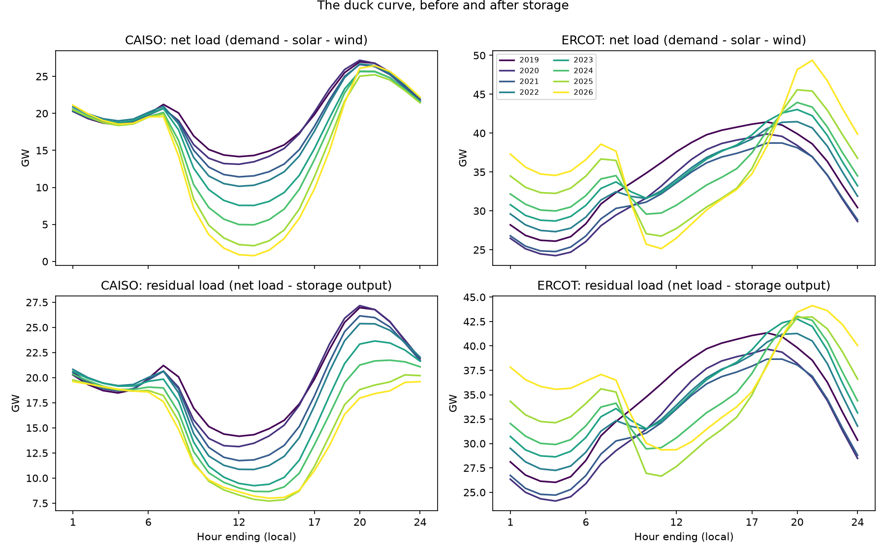
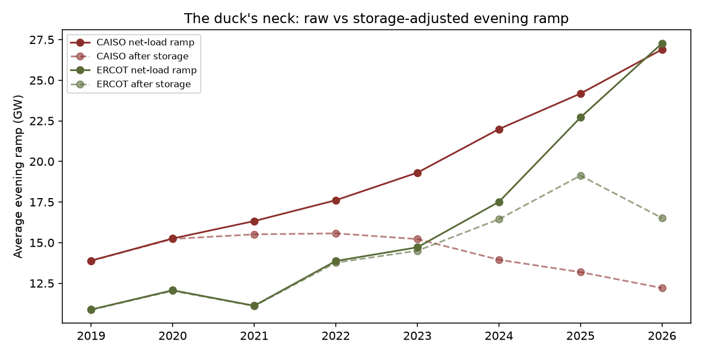
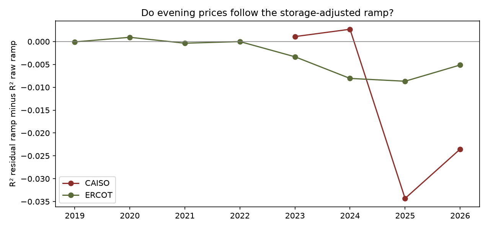

# D1 - Storage is reshaping the duck curve, and CAISO is further along than ERCOT

**Thesis.** In both CAISO and ERCOT, batteries are absorbing a growing share of the evening
net-load ramp (the duck's neck). CAISO, which built storage earlier, is further along. And once
storage matters, evening prices follow the storage-adjusted ramp rather than the raw one.

**Verdict.** Part 1 (storage shaving a growing share of the ramp): **supported**. Part 2 (CAISO further along): **supported**. Part 3 (prices follow the storage-adjusted ramp): **not supported**, but that test is biased against the idea; see section 2.

## How the duck is measured

- **Net load** = demand - solar - wind, hourly, local time (CAISO's own data for CAISO, EIA-930 for ERCOT).
- **Residual load** = net load - storage output. It's what gas plants and imports actually have to
  follow. CAISO reports battery charging and discharging directly in its own fuel-mix data. For ERCOT,
  storage comes from EIA-930's 'Other' and 'Battery' series, the same way as E2.
- **Evening ramp** = the day's evening (HE17-23) peak minus its midday (HE9-16) trough, in GW,
  computed separately for net load and residual load.
- **Storage shave** = the share of the net-load ramp that storage removes: 1 - residual ramp / net ramp.
- **Belly depth** = how far midday net load sinks below the day's peak demand. Above 100% means
  midday solar and wind exceeded demand that day, so the surplus had to be exported, stored or curtailed.

## 1. The duck, year by year

|                 | solar_share   | belly_depth   |   ramp_net |   ramp_res | storage_shave   |
|:----------------|:--------------|:--------------|-----------:|-----------:|:----------------|
| ('CAISO', 2019) | 13%           | 55%           |      13.89 |      13.88 | 0%              |
| ('CAISO', 2020) | 14%           | 60%           |      15.25 |      15.23 | 0%              |
| ('CAISO', 2021) | 16%           | 65%           |      16.33 |      15.51 | 5%              |
| ('CAISO', 2022) | 17%           | 70%           |      17.61 |      15.57 | 12%             |
| ('CAISO', 2023) | 19%           | 77%           |      19.31 |      15.22 | 21%             |
| ('CAISO', 2024) | 24%           | 86%           |      21.99 |      13.95 | 37%             |
| ('CAISO', 2025) | 27%           | 95%           |      24.18 |      13.18 | 45%             |
| ('CAISO', 2026) | 30%           | 101%          |      26.89 |      12.21 | 55%             |
| ('ERCOT', 2019) | 1%            | 38%           |      10.88 |      10.86 | 0%              |
| ('ERCOT', 2020) | 2%            | 43%           |      12.07 |      12.03 | 0%              |
| ('ERCOT', 2021) | 4%            | 45%           |      11.11 |      11.09 | 0%              |
| ('ERCOT', 2022) | 5%            | 50%           |      13.87 |      13.77 | 1%              |
| ('ERCOT', 2023) | 7%            | 51%           |      14.71 |      14.5  | 1%              |
| ('ERCOT', 2024) | 10%           | 55%           |      17.51 |      16.44 | 6%              |
| ('ERCOT', 2025) | 14%           | 62%           |      22.71 |      19.13 | 16%             |
| ('ERCOT', 2026) | 17%           | 67%           |      27.27 |      16.51 | 39%             |

Part 1 (storage shave growing): CAISO yes
(0% -> 55%), ERCOT yes
(0% -> 39%).
Part 2 (CAISO further along in 2026): yes.

## 2. Which ramp do evening prices follow?

Evening premium = (HE19-22 price - HE10-15 price) / Henry Hub, as in E2. For each market and year, two
regressions with the same controls (peak demand, month, weekday): one on the raw net-load ramp, one on
the residual ramp. A positive 'residual advantage' means the storage-adjusted ramp explains prices better.

| market   |   year |   days |   R² raw ramp |   R² residual ramp |   residual advantage |
|:---------|-------:|-------:|--------------:|-------------------:|---------------------:|
| ERCOT    |   2019 |    365 |         0.525 |              0.524 |               -0     |
| ERCOT    |   2020 |    366 |         0.276 |              0.277 |                0.001 |
| ERCOT    |   2021 |    354 |         0.404 |              0.404 |               -0     |
| ERCOT    |   2022 |    365 |         0.274 |              0.274 |               -0     |
| ERCOT    |   2023 |    365 |         0.632 |              0.629 |               -0.003 |
| ERCOT    |   2024 |    366 |         0.325 |              0.317 |               -0.008 |
| ERCOT    |   2025 |    365 |         0.288 |              0.279 |               -0.009 |
| ERCOT    |   2026 |    275 |         0.267 |              0.262 |               -0.005 |
| CAISO    |   2023 |    186 |         0.583 |              0.584 |                0.001 |
| CAISO    |   2024 |    362 |         0.586 |              0.589 |                0.003 |
| CAISO    |   2025 |    365 |         0.696 |              0.662 |               -0.034 |
| CAISO    |   2026 |    283 |         0.631 |              0.608 |               -0.024 |

Part 3 (residual ramp explains prices better in the two most recent years):
ERCOT no, CAISO no.

**Why this test is biased, and what to trust instead.** Residual load subtracts what batteries actually
did that day, and batteries discharge *more* on days when evening prices are high, because that's when
it pays. So on the most expensive evenings the residual ramp looks smaller than it would otherwise,
which weakens its link to price. Same-day dispatch is partly *caused by* the premium it's being used to
explain: the reverse-causality problem E2 avoided by measuring fleet *capability* instead. The clean
version of this question is E2 (and, for real-time spikes, E3), not this R² comparison. Part 3 is kept
here because it's an instructive way for a test to mislead.

## Trade and asset implications (hypothesis, not advice)

The duck's neck is what sets evening scarcity prices, but the neck that matters is the one left
*after* storage. Forecasting evening prices off gross solar build overstates the ramp in both
markets, and by more in CAISO. The useful forward indicator is the residual ramp: solar and load
growth minus the storage fleet's discharge capability. CAISO is a preview of where ERCOT's evening
shape is heading.

## Caveats

- **CAISO hourly prices only go back to mid-2023** in the free CAISO archive (OASIS keeps about three
  years). Earlier CAISO years are covered for the grid shape but not for part 3. Gridstatus's
  historical archive would fill that gap.
- **ERCOT storage reporting changed in Nov 2024.** Before that, EIA shows only evening discharge
  (charging is netted into demand); after, a separate battery series with charging. Residual load is
  computed consistently with each regime's accounting, but it is a seam in the data.
- **Why CAISO's own data instead of EIA's.** EIA-930's hourly CAISO series has a timing error: its
  solar output peaks about an hour too late from mid-2022 through 2025, which would bend the duck.
  CAISO's published fuel mix doesn't have the problem. ERCOT's EIA timing was checked the same way and
  is stable (solar centered at hour-ending 13.8-14.1 every year).
- For ERCOT, 'Other' includes small non-storage resources, which slightly blurs the storage measure.
- Imports matter a lot in CAISO (the Pacific Northwest and Southwest), and net load as defined here ignores them.
