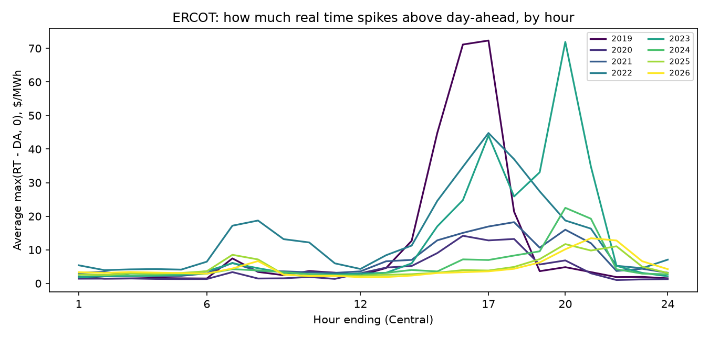
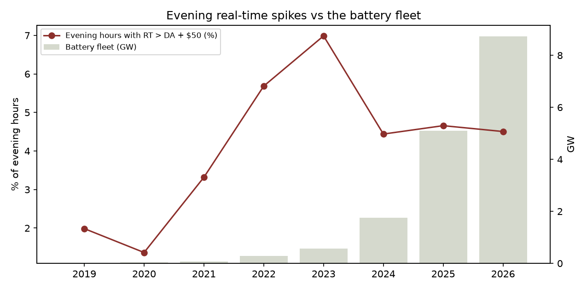

# E3 - ERCOT batteries are shrinking evening real-time price spikes

**Thesis.** Evening real-time (RT) prices spike above day-ahead (DA) when the evening turns out
tighter than expected. Batteries respond in seconds, so a bigger fleet should absorb more of those
surprises: evening RT spikes above DA should get smaller as the fleet grows.

**Why it matters for trading.** The DA/RT gap (DART = RT - DA) is what virtual traders trade. A *dec*
(buy DA, sell RT) wins when RT spikes above DA; an *inc* (sell DA, buy RT) wins when it doesn't. If
batteries are removing evening RT spikes, the payoff to holding evening RT exposure changes.

**Verdict.** **Supported.** The battery coefficient is negative and significant in every specification, including the tail.

Data: ERCOT hourly DA prices and 15-minute RT prices (averaged to hourly) at HB_HUBAVG, 2019 on,
excluding Winter Storm Uri; battery fleet, ramp and controls from the E2 daily panel.

## 1. The pattern (evening hours, HE19-22)

|   year |   mean_dart |   p95_dart | share_rt_spike   |   std_dart |   batt_fleet_gw |   evening_dec_pnl |
|-------:|------------:|-----------:|:-----------------|-----------:|----------------:|------------------:|
|   2019 |       -1.57 |      11.19 | 2.0%             |      23.97 |            0.03 |             -1.57 |
|   2020 |       -0.13 |       6.29 | 1.4%             |      37.59 |            0.04 |             -0.13 |
|   2021 |        2.1  |      22.78 | 3.3%             |      77.46 |            0.07 |              2.1  |
|   2022 |       -4.59 |      62.92 | 5.7%             |     128.93 |            0.28 |             -4.59 |
|   2023 |      -17.49 |      80.64 | 7.0%             |     325.38 |            0.57 |            -17.49 |
|   2024 |       -3.29 |      45.44 | 4.4%             |     114.51 |            1.75 |             -3.29 |
|   2025 |       -2.45 |      48.02 | 4.7%             |      54.74 |            5.1  |             -2.45 |
|   2026 |       -0.72 |      45.61 | 4.5%             |      54.49 |            8.73 |             -0.72 |

- `mean_dart`: average RT - DA, $/MWh. This is also the per-MWh result of mechanically buying every
  evening hour in DA and selling in RT ("always dec"), before fees.
- `p95_dart`: the size of the worst 5% of RT surprises.
- `share_rt_spike`: how often RT came in more than $50 above DA.

## 2. Regressions

Outcome: the day's evening upside DART, the average of max(RT - DA, 0) over HE19-22, divided by gas
(heat-rate units). Controls: evening ramp, net-load peak, wind share, month and weekday (HAC s.e.).

| model                           |   battery (per GW) |   s.e. |   p-value |    n |
|:--------------------------------|-------------------:|-------:|----------:|-----:|
| Main (OLS)                      |            -0.5005 | 0.1249 |    0.0001 | 2791 |
| + time trend                    |            -0.9228 | 0.1883 |    0      | 2791 |
| Excluding 2022                  |            -0.5509 | 0.139  |    0.0001 | 2426 |
| 2023+ only                      |            -0.958  | 0.1869 |    0      | 1371 |
| 90th percentile (quantile reg.) |            -0.6167 | 0.0915 |    0      | 2791 |

Main model: each extra GW of battery fleet lowers evening upside DART by 0.500 heat-rate units,
about $1.79/MWh at 2026's average gas price.

## What the pattern says

- **Day-ahead usually priced the evening above real time.** Average RT - DA was negative in 7 of 8 years, so mechanically buying day-ahead and selling in real time ('always dec') lost money on average.
- **That gap peaked in 2023 and has nearly closed:** -17.49 $/MWh in 2023 vs -0.72 in 2026.
- **Spikes got much smaller, but only somewhat rarer.** The spread of evening RT - DA (standard deviation) fell from 325 to 54 $/MWh, while the share of hours with RT more than $50 above DA only went from 7.0% to 4.5%.

## Trading implication (hypothesis, not advice)

Evening day-ahead prices used to carry an insurance premium: on average they cleared above real time,
because buyers paid up in day-ahead to avoid being exposed to rare, violent real-time spikes. Evening
incs (sell day-ahead, buy back in real time) collected that premium; evening decs were the insurance,
losing small amounts most days and paying off in the spikes. With storage absorbing the spikes, the
insurance is worth less and the market has priced that in: the premium has nearly disappeared. A
virtual book built on 2022-2023 evening behavior would expect a premium and a tail that are no longer
there.

## Caveats

- **Fees and collateral are ignored.** Real virtual trades carry ERCOT fees and credit costs that
  would eat into the small average spreads.
- **Hourly averages smooth 15-minute spikes.** The sharpest RT spikes last one or two intervals.
- **Battery growth tracks time.** The time-trend and 2023+ rows check this, but other things also
  improved, such as forecasting and ERCOT's new ancillary products (ECRS from mid-2023).
- **Same ERCOT battery-measure seam as E2** (EIA's reporting change in Nov 2024).
