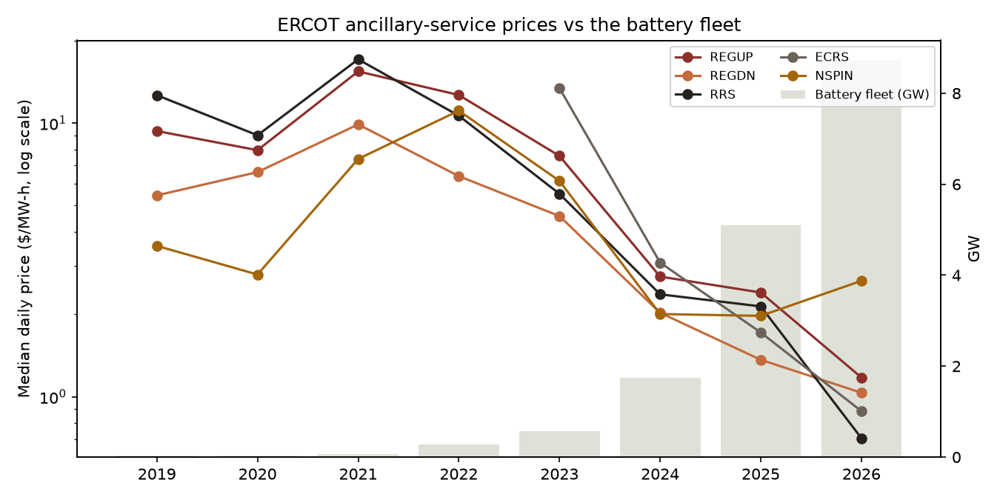
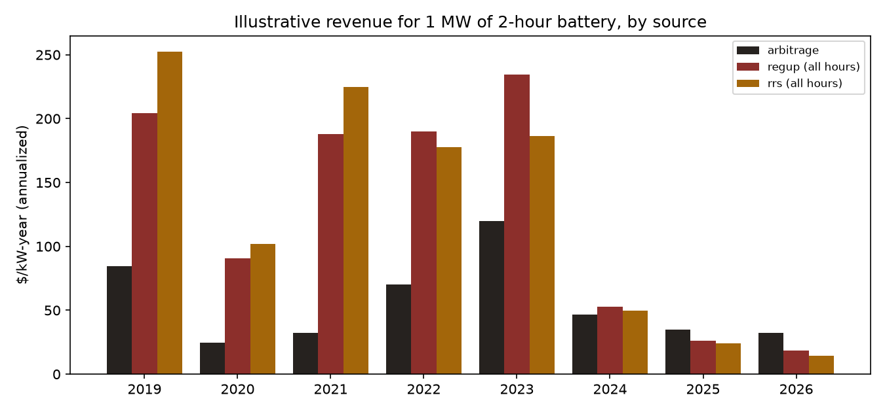

# E4 - Batteries have saturated ERCOT's ancillary-service markets

**Thesis.** Batteries are ideal for ERCOT's fast reserve products (Regulation Up and Responsive Reserve),
and the early fleet earned most of its money there. As the fleet grew, those prices should have collapsed,
pushing battery revenue toward energy arbitrage, which E2 shows is also being competed away.

**Verdict.** **Supported** for the fast products batteries dominate (REGUP, RRS): prices fall with the fleet in every specification.

## The products

| Product | What it pays for | Battery fit |
|---|---|---|
| REGUP / REGDN | Following ERCOT's second-by-second frequency signal | Excellent |
| RRS | Responding within seconds when a large plant trips | Excellent |
| ECRS (from June 2023) | A slower backstop for the same events | Good |
| NSPIN | Capacity that can start within 30 minutes | Fair (duration matters) |

Prices are day-ahead clearing prices in $ per MW per hour of standby capacity (ERCOT report NP4-181-ER).

## 1. Prices vs the fleet (median daily price, $/MW-h)

|   year |   regup |   regdn |   rrs |   ecrs |   nspin |   batt_fleet_gw |
|-------:|--------:|--------:|------:|-------:|--------:|----------------:|
|   2019 |    9.36 |    5.44 | 12.65 | nan    |    3.56 |            0.03 |
|   2020 |    7.96 |    6.62 |  9.03 | nan    |    2.8  |            0.04 |
|   2021 |   15.45 |    9.89 | 17.11 | nan    |    7.4  |            0.07 |
|   2022 |   12.67 |    6.4  | 10.64 | nan    |   11.1  |            0.28 |
|   2023 |    7.59 |    4.57 |  5.52 |  13.42 |    6.15 |            0.57 |
|   2024 |    2.75 |    2.03 |  2.37 |   3.09 |    2    |            1.75 |
|   2025 |    2.4  |    1.36 |  2.14 |   1.72 |    1.97 |            5.1  |
|   2026 |    1.18 |    1.03 |  0.71 |   0.89 |    2.65 |            8.73 |

## 2. Regressions on log price

Controls: log gas price (reserves are priced partly off the energy a resource gives up), net-load peak,
month, weekday (HAC s.e.). '% per GW' converts the log coefficient into the percentage change in price
for each extra GW of battery fleet.

| product   | model        |   battery (per GW) |   % per GW |   p-value |    n |
|:----------|:-------------|-------------------:|-----------:|----------:|-----:|
| REGUP     | main         |            -0.3057 |   -26.336  |         0 | 2791 |
| REGUP     | + time trend |            -0.2104 |   -18.9748 |         0 | 2791 |
| REGUP     | 2023+ only   |            -0.2767 |   -24.1734 |         0 | 1371 |
| REGDN     | main         |            -0.2302 |   -20.5612 |         0 | 2791 |
| REGDN     | + time trend |            -0.1304 |   -12.2295 |         0 | 2791 |
| REGDN     | 2023+ only   |            -0.2107 |   -18.9959 |         0 | 1371 |
| RRS       | main         |            -0.3599 |   -30.2248 |         0 | 2791 |
| RRS       | + time trend |            -0.2056 |   -18.5869 |         0 | 2791 |
| RRS       | 2023+ only   |            -0.316  |   -27.0938 |         0 | 1371 |
| ECRS      | main         |            -0.3264 |   -27.8507 |         0 | 1211 |
| ECRS      | + time trend |             0.3397 |    40.4514 |         0 | 1211 |
| ECRS      | 2023+ only   |            -0.3264 |   -27.8507 |         0 | 1211 |
| NSPIN     | main         |            -0.184  |   -16.8054 |         0 | 2791 |
| NSPIN     | + time trend |            -0.1752 |   -16.0703 |         0 | 2791 |
| NSPIN     | 2023+ only   |            -0.1405 |   -13.1048 |         0 | 1371 |

## 3. Where a battery's money comes from (illustration)

|   year |   arbitrage |   regup (all hours) |   rrs (all hours) |
|-------:|------------:|--------------------:|------------------:|
|   2019 |        84.7 |               204.3 |             252.3 |
|   2020 |        24.9 |                90.4 |             101.7 |
|   2021 |        32.5 |               187.9 |             224.6 |
|   2022 |        70.1 |               189.8 |             177.9 |
|   2023 |       119.6 |               234.7 |             186.3 |
|   2024 |        46.5 |                52.6 |              49.7 |
|   2025 |        34.8 |                26.1 |              24.2 |
|   2026 |        32.5 |                18.4 |              14.4 |

For 1 MW of a 2-hour battery, in $/kW-year: daily arbitrage (charge in the 2 cheapest day-ahead hours,
discharge in the 2 priciest, 85% efficiency) vs selling REGUP or RRS every hour. The reserve columns are an
upper bound: a real battery splits its capacity and can't sell the same MW as energy and reserves at once.

## Trade and asset implications (hypothesis, not advice)

Reserve revenue was the easy money for early Texas batteries, and it's gone. New storage has to earn its
keep in energy arbitrage and real-time volatility, both of which the existing fleet is also compressing
(E2, E3). Battery valuations built on 2022-2023 ancillary prices overstate future revenue, and the next
GW of storage earns less than the last on every revenue line.

## Caveats

- **ERCOT changed how much reserve it buys.** After Winter Storm Uri it bought far more (2021-2022), added
  ECRS in mid-2023, and has trimmed quantities since. Those policy shifts move prices independently of
  batteries; the time-trend and 2023+ rows only partly separate them.
- **Gas matters.** Reserve prices partly reflect the energy a resource gives up by standing by; the
  log-gas control handles the level but not every interaction.
- **The revenue table is illustrative,** not a dispatch model: no state of charge, degradation,
  real-time prices or co-optimization.
